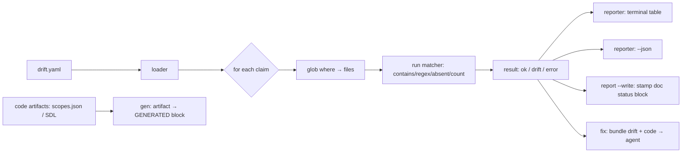

# driftdoc — a generic doc↔code drift engine

> **📊 DOC STATUS — updated 2026-06-29:** ✅ design locked · ✅ **BUILT: `check` (Tier-1) · `init` · `report --write` (doc stamping) · `impact` (reverse-impact, moat #1)** — all proven on the live sample-api tree (9/9 claims green; stale-path flagged; impact found 2 affected claims across 128 changed files) · ⏳ pending: `gen` (Layer 2) · `fix` (AI) · Tiers 2–4 (structured/AST/live) · coverage + CI bot — **🟡 ALPHA — core + the top moat pillar work; rest is roadmap.**

**Status:** Phase 1 (MVP `check`) **shipped**. Phases 2–6 (report/gen/fix + reverse-impact + Tiers 2–4 + coverage/CI) are the roadmap below.

**One line:** docs rot because claims in prose silently fall out of step with the code. `driftdoc` makes every claim **machine-checkable** against the code via a small set of generic matchers declared as data (`drift.yaml`) — so "is this doc still true?" becomes a command that exits non-zero on drift, not a manual re-read.

---

## 0 · Why this exists (the problem)

A doc says "the API is at `/api/admin/v1/query`" or "the robot user was removed". Months later the code changes; the doc doesn't. Nobody notices until someone trusts a stale line. Today the only fix is a human/AI re-reading the whole doc against the whole codebase — slow, and easy to miss things.

Two non-solutions we explicitly reject:

- **Hand-writing a regex/extractor per fact.** Doesn't scale — hundreds of facts, hundreds of bespoke checks to maintain.
- **Pinning to `file:line`.** Line numbers move on every edit above them; the pin rots immediately.

The engine's whole job: a **generic** check over **declarative** claims, reusable for any doc and any codebase (Go, TS, SQL, config, other markdown).

---

## 1 · The core model — a "claim"

A claim is three things: **what we assert**, **where to look**, **what we expect to find**. Drift = the expectation no longer holds.

```yaml
- id: apiadmin-versioned
  desc: apiadmin GraphQL is served at /api/admin/v1/query (versioned)
  where: modules/apiadmin/boot.go      # a file OR a glob
  match: contains                       # which generic matcher to run
  expect: "/api/admin/v1/query"         # the matcher's argument
```

You scale by **adding rows**, never by adding engine code. The engine is one loop: for each claim, run its matcher over the matched files, record ✅ / ⚠️.

<Callout type="tip" title="The key realization">

There is no per-fact code. ~5 generic matchers cover everything; each claim just picks one and supplies an argument. `contains`/`absent`/`count` need no pattern at all.

</Callout>

---

## 2 · `drift.yaml` — the registry (sidecar, chosen)

Claims live in a sidecar file (one per doc, or one per repo). Chosen over inline so the check-spec is separated from prose; the tradeoff (claim text + spec live apart) is mitigated by `report` mode stamping live status back into the doc, and by `desc`/`section` linking each row to where it's documented.

```yaml
version: 1

defaults:
  root: .                              # repo root that globs resolve against
  doc: docs/sync/addons/ADDONS.md      # default doc these claims back (for `report` stamping)

claims:
  - id: apiadmin-versioned
    desc: apiadmin GraphQL at /api/admin/v1/query (versioned; no unversioned alias)
    section: "#api-reference"           # anchor in the doc — for report + navigation
    where: modules/apiadmin/boot.go
    match: contains
    expect: "/api/admin/v1/query"

  - id: robot-removed
    desc: robot/system user removed from provisioning
    where: "modules/**/*.go"            # doublestar glob
    match: absent                        # must appear in ZERO matched files
    expect: "EnsureSystemUser"

  - id: onboard-owner-required
    desc: provisioning errors when the app has no owner workspace
    where: modules/addons/provision/provision.go
    match: regex
    expect: 'OwnerWorkspaceID == ""'

  - id: whoami-nested
    desc: whoami exposes the nested installation context
    where: modules/apiadmin/schemas/apiadmin.graphql
    match: contains
    expect: "installation: InstallationContext"
```

**Row fields:** `id` (stable), `desc` (human claim), `where` (file or doublestar glob, relative to `root`), `match` (matcher name), `expect` (matcher arg), optional `count` (for `count`), optional `section`/`doc` (override the default doc/anchor), optional `note`.

---

## 3 · Matchers — the only "engine code" (generic + reusable)

| matcher | arg | passes when | notes |
|---|---|---|---|
| `contains` | substring | the substring appears in ≥1 matched file | language-agnostic; the default |
| `regex` | RE2 pattern | the pattern matches in ≥1 file | Go `regexp` (RE2 — no catastrophic backtracking) |
| `absent` | substring/pattern | appears in **0** matched files | for documented deletions/removals |
| `count` | substring/pattern + `count: N` | appears **exactly N** times across matched files | e.g. "one active-token index" |
| `symbol` *(v2)* | symbol name | the function/type/const exists | AST-backed (go/packages, tree-sitter); rename-proof only with the marker variant |
| `jsonpath` *(v2)* | path + expected | a structured file (`.json`/`.yaml`) has the value | for SDL-as-json, config, OpenAPI |

`contains` / `absent` / `count` take a literal string — **zero regex authoring**. `regex` takes a pattern, but that pattern is the *row's data*, not engine code. That's the whole surface: ~150 lines, four matchers for the MVP, two more in v2.

<Callout type="warning" title="Rename resilience (the one honest limit)">

No text token survives an arbitrary rename — and it shouldn't: a rename is a real change you WANT flagged. A `contains`/`symbol` miss IS the alarm. For claims pinned to an internal symbol with no stable contract string, use the v2 **marker variant**: drop `// drift:onboard-owner-required` next to the code symbol and match `marker:onboard-owner-required` — the comment travels with the code through renames; only deleting the feature trips it.

</Callout>

---

## 4 · CLI surface

<Tabs>
  <Tab label="check (CI / Layer 3)">

  ```bash
  driftdoc check                       # all claims in ./drift.yaml
  driftdoc check --config addons.drift.yaml
  driftdoc check --json                # machine-readable results
  driftdoc check --filter id=apiadmin-versioned
  # exit 0 = all OK · 1 = drift found · 2 = config/IO error
  ```

  Prints a per-claim table (id · status · where · matched-files). Non-zero exit on drift → drop into CI and the doc can never silently rot.

  </Tab>
  <Tab label="report (stamp the doc)">

  ```bash
  driftdoc report --write              # stamp status table + "Last verified: <date>" into the doc
  ```

  Writes a `<!-- driftdoc:status -->…<!-- /driftdoc:status -->` block (a filemark datagrid) into each `doc` so the rendered doc shows freshness + which claims are green.

  </Tab>
  <Tab label="gen (Layer 2 — generated blocks)">

  ```bash
  driftdoc gen                         # refresh GENERATED blocks from code artifacts
  ```

  Generic renderer: gets the data without touching the consumer codebase (DD9) — via (A) a throwaway `/tmp` importer driftdoc runs + deletes, (B) a `//go:build ignore` dumper under `tools/` (excluded from all builds), or (C) an existing artifact (SDL/OpenAPI) — then renders it as markdown between `<!-- GENERATED:<id> -->` markers. The renderer is generic — no per-section regex.

  </Tab>
  <Tab label="fix (AI repair loop)">

  ```bash
  driftdoc fix --id whoami-nested      # bundle the drifted claim + code context for an agent
  ```

  For each drifted claim, emits a context bundle (the claim, the `desc`, the doc section, the current code around `where`) the agent uses to propose the doc edit (strike-not-delete) + correct the `expect`. Human reviews.

  </Tab>
</Tabs>

---

## 5 · Architecture



Pure functions end to end: load → glob → match → results → reporters. No state, no DB. Globs via doublestar; matching via `strings`/`regexp`. The `fix` and `gen` paths are additive consumers of the same result set.

---

## 6 · The three layers, restated generically

| Layer | What `driftdoc` provides | Cost |
|---|---|---|
| **L1 — detect** | `check` + `report` over `drift.yaml`; run on demand | the matchers (~150 LOC) + writing claim rows |
| **L2 — generate** | `gen`: code dumps facts → generic artifact→markdown renderer | a 3-line "dump to json" per data source |
| **L3 — enforce** | `driftdoc check` in CI → red on drift; merge blocked until doc fixed | one CI step |

They stack: L1 is the foundation, L2 makes high-churn data sections impossible to drift, L3 makes it self-enforcing with no human in the loop.

---

## 7 · Decisions

| # | Decision | Choice | Why |
|---|---|---|---|
| DD1 | Form factor | **Go CLI on PATH** | fits the Go-heavy stack; CI-friendly exit codes; language-agnostic matchers; reusable across repos |
| DD2 | Claim registry | **sidecar `drift.yaml`** | clean separation of check-spec from prose; one file to scan; `report` stamps status back into the doc to bridge the gap |
| DD3 | Matchers | **generic set: contains/regex/absent/count (+symbol/jsonpath v2)** | no per-fact code; every claim is a data row picking a matcher |
| DD4 | Anchoring | **stable contract strings; `file:line` banned; marker comments for slippery symbols (v2)** | line numbers rot; a miss is the intended drift alarm |
| DD5 | Regex engine | **Go `regexp` (RE2)** | linear-time, no catastrophic backtracking on hostile patterns |
| DD6 | Globs | **doublestar (`**`)** | match across trees without per-claim file lists |
| DD7 | Generated blocks | **code dumps artifact → ONE generic renderer** | avoids a bespoke extractor/regex per generated section |
| DD8 | First consumer | **the sample-api addon docs (`ADDONS.md`)** | dogfood on the doc set we just audited; ~15 high-value claims ready to encode |
| DD9 | No pollution of the consumer codebase | **`check` adds NOTHING to the repo (grep-only). Layer-2 data is read via: (A) a throwaway /tmp importer driftdoc runs + deletes, (B) a `//go:build ignore` dumper under `tools/` excluded from all builds, or (C) an existing artifact (SDL/OpenAPI). Never a dumper inside business packages.** | the engine lives in its own repo; the consumer repo stays clean. Detection = zero footprint; generated-lists = zero or fenced-off footprint |

---

## 8 · MVP scope + build phases

Phase 1 is the smallest thing that's already useful (generic L1 + L3 via exit code). Each phase ends `go build` clean + a tiny test.

### Phase 1 — MVP (`check`) — ✅ SHIPPED 2026-06-29

- [x] `drift.yaml` schema + loader (YAML → typed structs; KnownFields; version + dup-id + matcher validation) — `config/`
- [x] doublestar glob resolver (relative to `root`, files-only) — `globs/`
- [x] matchers: `contains`, `absent`, `regex`, `count` — `match/` (+ `match_test.go`, green)
- [x] `driftdoc check` — per-claim terminal table + exit codes (0/1/2) — `cmd/driftdoc/`
- [x] `--json` and `--filter id=…`
- [x] `driftdoc init` (scaffold) + colored output (auto/always/never)
- [x] Authored `addons.drift.yaml` (9 claims) against the real addon docs/code — **9/9 green; stale-path claim flagged DRIFT (exit 1)**

### Phase 2 — `report --write` (doc stamping) — ✅ SHIPPED 2026-06-29

- [x] `report` builds a per-doc status block (verdict banner + per-claim GFM table, `verified <date>`) — `report/` `BuildStatusBlock`
- [x] groups claims by effective doc (`config.EffectiveDoc`); `--write` stamps each, preview otherwise
- [x] idempotent marker replace (`<!-- driftdoc:status -->`…); first run inserts after the doc's H1 — `report/` `StampDoc`

### Reverse impact (moat pillar #1) — ✅ SHIPPED 2026-06-29

- [x] `impact` pkg: changed-files (git diff or `--files`) → claims whose `where` covers them — `impact/Analyze`
- [x] `driftdoc impact --git <ref> | --files …` (+ `--exit-code` gate) — proven on the live sample-api tree (128 changed files → 2 documented claims flagged with their doc)

### Phase 3 — `gen` (Layer 2)

- [ ] generic artifact→markdown renderer between `<!-- GENERATED:<id> -->` markers
- [ ] sample: `scopes.json` dumped from `pimscope.All` via `go:generate` → rendered scope table

### Phase 4 — `fix` (AI loop)

- [ ] emit a context bundle per drifted claim (claim + desc + doc section + code window)
- [ ] optional: shell out to an agent; otherwise print the bundle for a human/agent

### Phase 5 — v2 matchers + rename resilience

- [ ] `symbol` matcher (Go via go/packages; TS via tree-sitter)
- [ ] `marker:<id>` matcher + `// drift:<id>` convention
- [ ] `jsonpath` matcher for structured files

### Phase 6 — CI guard (Layer 3)

- [ ] `task drift` / CI step running `driftdoc check`; red on drift
- [ ] doc: how to add a claim, how to fix drift

---

## 9 · Open questions

- **Multi-doc per repo:** one `drift.yaml` with per-claim `doc`, or one yaml per doc? (Lean: one repo-level `drift.yaml`, `doc` per claim.)
- **`expect` for `count`:** separate `count:` field vs encode in `match: count=3`? (Lean: separate field, clearer.)
- **`report` placement:** status block at top of doc (visible) vs bottom appendix? (Lean: a compact top banner + a full appendix datagrid.)
- **Whitespace/comment-insensitive matching:** do we ever need to ignore formatting? (Defer — `contains` on contract strings sidesteps it; `symbol` handles the rest in v2.)

---

## 10 · First consumer — the addon docs

The 16 docs we just audited become the proving ground: encode the load-bearing facts as `addons.drift.yaml` claims — `/api/admin/v1/query`, `authorization_code` (not `client_credentials`), robot-removed (`absent: EnsureSystemUser`), `whoami` nested, `Map`-scalar-gone, `examples/addondemo` exists, `setInstallMetadata` no-scope, etc. `driftdoc check` then becomes the one-command answer to "are the addon docs still true?" — replacing this session's manual re-audit.
